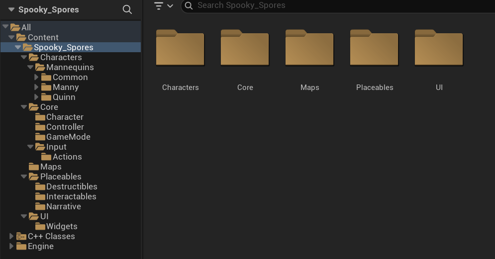
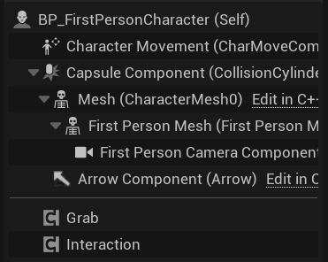
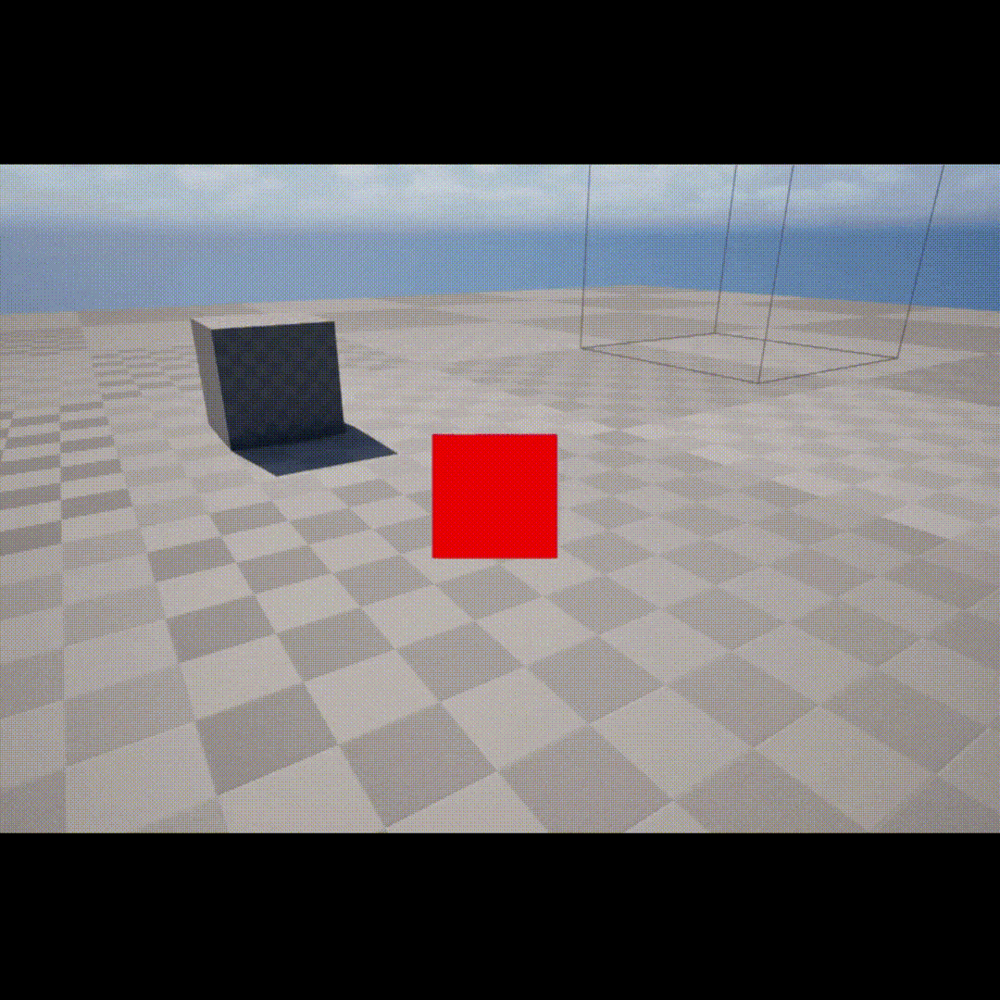
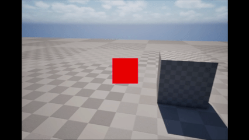
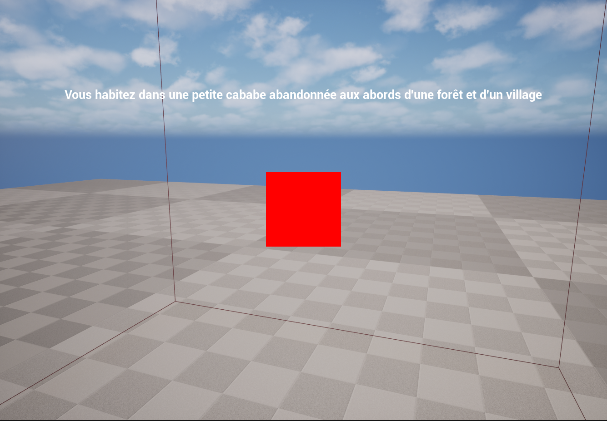
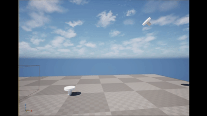
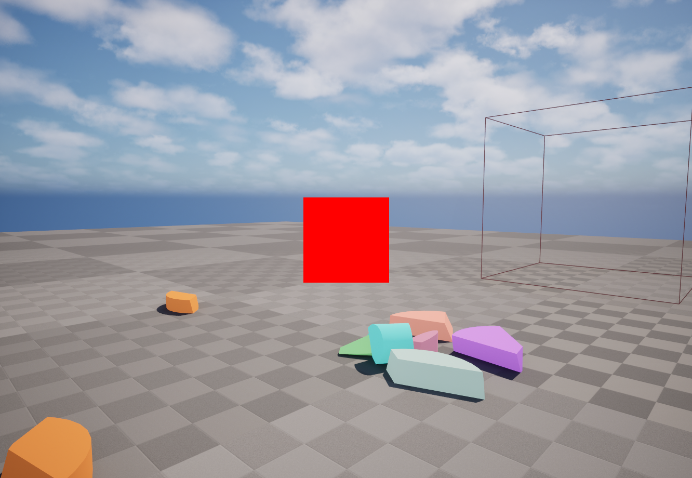

# Documentation technique — Spooky_Spores

Unreal Engine 5.8.3. Architecture **actuelle**, par système (pas d'historique). Règles et pièges : `CLAUDE.md`. 3C (contrôles, caméra, valeurs) : `README.md`. Intention de conception : `GDD.md`. Reste à faire : `TODO.md`.

---

## 1. Contexte

*Spooky_Spores* : bac à sable où le joueur, nécromancien dans une cabane aux abords d'une forêt et d'un village, manipule des objets (télékinésie), récolte, développe sa base et la défend contre le village voisin. Cartes : `Lvl_Principal` (par défaut), `Lvl_FirstPerson` (test).

---

## 2. Architecture globale

```
Player (ASpooky_SporesCharacter)
   ├── UInteractionComponent     → détecte ce que le joueur regarde
   ├── UGrabComponent            → manipule physiquement l'objet détecté
   ├── UResourceCounterComponent → compte les ressources
   ├── UStaminaComponent         → endurance (sprint)
   ├── UHealthComponent          → santé
   └── UManaComponent + USpellCastingComponent → sorts
Objets interactifs (IGrabbable et/ou IInteractable) → Physique (Chaos) → Environnement
```

Aucun système ne connaît l'implémentation d'un autre. Quand deux composants doivent se coordonner (relâcher un objet avant d'interagir), le Character arbitre.

**Code** (`Source/Spooky_Spores/`), un dossier par domaine :
```
CollisionChannels.h   alias des canaux de collision custom
Core/        Character/ (Spooky_SporesCharacter, CameraManager), Controller/, GameMode/
Interaction/ Grabbable, Interactable, InteractionComponent, GrabComponent, PhysicsGrabbable
Narrative/   StoryTrigger
Resources/   ResourceTypes, ResourceCounterComponent, ResourceDrop, HarvestableResource, Cauldron, FieldPlot
Movement/    StaminaComponent
Health/      HealthComponent
Spells/      ManaComponent, SpellCastingComponent
Enemies/     EnemySoldier, EnemyAIController, EnemyPathSpline, Destructible
Servants/    Servant, ServantAIController
Base/        BaseZone, BaseZoneSubsystem
Tests/       Automation Specs (code de test du module, pas un domaine de gameplay)
```

**Content** (`Content/Spooky_Spores/`) : `Core/` (briques structurantes : Character, Controller, GameMode, Input), `Placeables/` (instances concrètes : Base, Interactables, Narrative, Destructibles, Resources, Servants), `UI/Widgets/`, `Characters/Mannequins/`, `Maps/`. Inspiré du [style guide d'Allar](https://github.com/Allar/ue5-style-guide).



---

## 3. Interaction et manipulation physique

| Classe | Rôle |
|---|---|
| `IGrabbable` | Objet saisissable ; `GetGrabbableComponent()` renvoie le `UPrimitiveComponent` à manipuler (`nullptr` par défaut) |
| `IInteractable` | Comportement générique sans manipulation ; `OnInteract(AActor* InteractingActor)` |
| `UInteractionComponent` | Détection (un trace par frame) |
| `UGrabComponent` | Grab, maintien, lancer via `UPhysicsHandleComponent` |
| `APhysicsGrabbable` | Objet physique concret (ex. `BP_Rock`) |

Un objet implémente l'une des interfaces, l'autre ou les deux (ségrégation des interfaces).



**Détection** : un unique `LineTraceSingleByObjectType` (canal `Interactable`) par frame, depuis la vraie caméra, à la plus grande des portées plutôt que deux traces (DRY, coût négligeable). Fonctions : `IsGrabbableTarget(OutComponent)` (`GrabRange` 400), `IsInteractableTarget()` (`InteractRange` 200), `IsAttackableTarget(OutTarget)` (`AttackRange` 200), `GetPlacementPoint` (section 12). Sans cible, `CurrentTargetDistance` vaut `TNumericLimits<float>::Max()` (pas 0) pour qu'une comparaison échoue naturellement ; la cible est un `TWeakObjectPtr<AActor>`.



**Grab / Release / Launch** : `Grab()` maintient l'objet devant la caméra (`HoldDistance` 200) via `SetTargetLocationAndRotation` au tick, sans raideur ajoutée (impression de poids). `Release()` ne neutralise pas la vélocité (l'inertie de la caméra se transmet, c'est voulu). `Launch()` applique une impulsion en mode vélocité (`LaunchImpulseStrength` 1000, indépendante de la masse) dans le regard, puis relâche. Push a été fusionné dans Release. La masse reste au calcul automatique de Chaos.

**Touche E** (`DoInteractAction`) arbitre : objet tenu → le reposer ; sinon cible grabbable → saisir ; sinon interactable → `OnInteract`.



**Collision** : canal `Interactable` aliasé en `COLLISION_INTERACTABLE` (`CollisionChannels.h`) ; preset `PhysicsInteractable` (Query and Physics, requis pour le trace et la simulation). `ASpooky_SporesCharacter` override `GetActorEyesViewPoint()` pour renvoyer la vraie caméra (le défaut `Location + BaseEyeHeight` est faux avec un socket décalé) : tous les traces s'en servent.

---

## 4. Ressources

`EResourceType` (`Resources/ResourceTypes.h`) : `Seed`, `Wheat`, `Wood`, `Stone`, `Potion`, `Bone`, `Necrospore` (dans cet ordre). Un nouveau type s'ajoute **en fin** pour ne pas décaler les valeurs existantes ; il demande aussi une entrée dans `WBP_ResourceCounter`.

**`UResourceCounterComponent`** : `TMap<EResourceType, int32>` privée (lisible en Blueprint), `AddResource`, `GetResourceCount`, `TrySpendResource` (faux sans rien retirer si le stock manque ; utilise `Find`, jamais `FindOrAdd`), délégué `FOnResourceChanged` (modèle *push*, la donnée change ponctuellement). Montant nul ou négatif refusé avec warning (sinon `TrySpendResource(Type, -5)` ajouterait 5).

**`AHarvestableResource`** (`IInteractable`) : coupe sa collision, fait apparaître ses drops (`TArray<FResourceDropEntry>`, position aléatoire dans `DropSpawnRadius`), se détruit. S'il porte un `UHealthComponent`, la récolte au E est désactivée et le nœud se récolte à sa mort (`OnDeath`) : `BP_Harvestable_Wood` et `_Stone` le portent, `_Plant` non. Aucun code pour décider qu'un nœud est « vivant ».

**Spawn différé** : `AResourceDrop::SpawnDrops` (statique, partagée par nœuds, champs et butin ennemi) utilise `SpawnActorDeferred` → `InitializeDrop(Type, Amount)` → `FinishSpawning`, car `SpawnActor` exécute `BeginPlay` et les overlaps avant de rendre la main (un drop était ramassé avant d'avoir ses données). `FResourceDropEntry` vit dans `ResourceTypes.h` (évite un include circulaire).

**`AResourceDrop`** : preset `ResourceDrop` (les drops s'ignorent entre eux). `BeginPlay` : saut initial (`VRandCone`, vélocité), puis `PickupDelay` pendant lequel les overlaps sont ignorés. Atterrissage (normale `Z >= MinGroundNormalZ` 0.7) : physique coupée, yaw conservé, position recalée via les `Bounds` du mesh (fonctionne sur pente). `TryCollect` renvoie un `bool` (pas de double ramassage) et exige un `UResourceCounterComponent` sur le ramasseur (un ennemi n'en a pas).

**UI** : `WBP_ResourceEntry` (une ressource, filtrée par `Equal (Enum)`) et `WBP_ResourceCounter` reçoivent le compteur (`InitializeCounter`) au lieu de le chercher, pour ne pas dépendre de l'ordre d'initialisation Character/UI.

---

## 5. Sprint et endurance

`UStaminaComponent` : l'endurance, indépendante de la vitesse (le Character arbitre). `TryStartSprint()` refuse si `CurrentStamina <= 0` ; le tick décrémente en sprint et régénère après `RegenDelay` (4 s). Le délégué `FOnSprintStateChanged` signale aussi l'arrêt **forcé** par épuisement.

La vitesse (`MaxWalkSpeed`) n'est modifiée qu'à un endroit, `HandleSprintStateChanged` (lié au délégué) : arrêt volontaire ou forcé, même chemin. Push pour l'état (discret), pull pour l'affichage : `WBP_StaminaBar` lit `GetStaminaRatio()` dans son `Event Tick` (un délégué par frame ne ferait que déplacer le tick).

---

## 6. Champs et chaudron

**`AFieldPlot`** (`IInteractable`, réutilisable) : états `Empty` → `Growing` → `Grown` pilotés par `OnInteract` (une touche contextuelle). Planter : `TrySpendResource(SeedCost)` puis un `SetTimer` unique de `GrowthDuration` (pas de tick : une échéance, pas une valeur continue). Récolter : spawn des drops (graines + `Wheat`), retour à `Empty`.

**`ACauldron`** (`IInteractable`, réutilisable) : états `Idle` → `Brewing` → `Ready`, un seul point d'entrée `OnInteract`.
- **Recettes = données** : `TArray<FCauldronRecipe> Recipes` éditable (ingrédients `TMap<EResourceType,int32>`, `OutputType`, `OutputAmount`, `BrewDuration`). Ajouter une recette ne demande aucun C++.
- **Idle** : `FindFirstAffordableRecipe` prend la **première recette payable** dans l'ordre du tableau (simple, prévisible ; risque de lancer une recette non voulue tant qu'il n'y a pas d'UI de sélection). `CanAfford` puis dépense en deux passes (jamais de consommation partielle). Lance un `FTimerHandle`.
- **Brewing** : aucune action. **Ready** : `CollectOutput` crédite le résultat, retour à `Idle`.
- `ActiveRecipeIndex` (`INDEX_NONE` si vide) mémorise la recette choisie : un pointeur dans le `TArray` pourrait être invalidé, une copie dupliquerait la donnée. Lectures protégées par `IsValidIndex`.
- **Garde-fous** : recette sans ingrédient ignorée (sinon résultat gratuit) ; `BrewDuration` nulle termine immédiatement (un `SetTimer` de durée 0 ne se déclenche jamais).
- `GetBrewProgress()` (pure) calcule un ratio depuis `GetTimeSeconds() - BrewStartTime` ; `WBP_CauldronProgress` l'interroge au tick (pull).
- **La potion est créditée directement**, sans drop physique : un pickup pour un objet qui finira dans un inventaire serait du travail jetable.

**Recettes actuelles** : 1. 3 Bois + 1 Pierre + 2 Blé → 1 Potion. 2. Os + 1 Potion → 1 Necrospore (objet de résurrection, section 12).

**Debug** (par instance via `bShowDebug`) : sphère colorée selon l'état (gris/rouge/vert, aussi sur `AFieldPlot`) ; le chaudron affiche en plus recette et avancement (`DrawDebugString` durée `0`, `-1` s'accumulerait à chaque tick).

---

## 7. Narration

`AStoryTrigger` : `UBoxComponent` (preset `Trigger`), `StoryText` (`FText`) par instance, garde `bTriggerOnce`, `BlueprintImplementableEvent OnStoryTriggered()` : le C++ déclenche, le Blueprint décide. `BP_StoryTrigger_Entrance` (porte de la cabane) affiche `WBP_StoryText` (`ShowText(Message)` en Custom Event, car il utilise un `Delay`).



---

## 8. Chaos (fracture)

`GC_Mushroom` : Geometry Collection (Fracture Mode, Uniform Voronoi). `Damage Threshold` `5000 / 500 / 50` par niveau de hiérarchie (abaissé pour des impacts réalistes), `Enable Damage From Collision` activé. Il se fracture sous la chute ou sous un objet lancé par `Launch()`.



---

## 9. Santé et sorts

**`UHealthComponent`** : générique, s'abonne à `OnTakeAnyDamage` du propriétaire (déclenché par tout `ApplyDamage`). Délégués `OnHealthChanged` et `OnDeath` (une fois, à 0).

**`UManaComponent`** : comme l'endurance, mais sans délai de recharge (la mana doit rester disponible). `TrySpendMana(Cost)` échoue sans effet de bord.

**`USpellCastingComponent`** : point d'entrée du clic gauche (`IA_CastSpell`) = lancer le sort équipé (aujourd'hui un seul : le coup de bâton). `TryCastSpell()` vérifie la mana, puis deux timers : `HitDelay` (0.2 s) → `ResolveHit()`, `SwingCooldown` (0.5 s) → `EndSwing()` (lève `bIsSwinging`, anti-spam). `ResolveHit()` réutilise `IsAttackableTarget` (pas de nouveau trace) puis `ApplyDamage` : aucun couplage direct avec la santé de la cible. **Hitscan** : un futur sort à distance passera par un projectile sans changer mana, dégâts ni santé. Le coût en mana du coup de bâton est `0` **par la donnée** (`SpellManaCost` : 20 par défaut dans le C++, réglé à 0 sur l'instance), pas par une branche de code.

---

## 10. Environnement

`Lvl_Principal` (`EditorStartupMap` / `GameDefaultMap`, `Config/DefaultEngine.ini`) : un **Landscape** en colline, cabane au sommet (vue dégagée sur le chemin du village, cf. *An Architectural Approach to Level Design*, C. Totten). Cabane en géométrie directe dans le niveau (unique), fenêtre, lumière intérieure. `BP_Fences` délimite le territoire (la zone de base l’englobe sans en dépendre, section 13). Placés : `BP_StoryTrigger_Entrance`, `BP_Cauldron`, plusieurs `BP_FieldPlot`, `BP_Rock`, trois `GC_Mushroom`. Scène volontairement sombre (Post Process, Exposure Compensation négative, Directional Light faible).

**Foliage Mode avec type Actor** (pas Static Mesh) pour disperser `BP_Harvestable_*` : nécessaire pour garder la logique par instance ; aucun gain de performance (chaque exemplaire reste un acteur), seul le confort de placement compte.

---

## 11. Ennemi (soldat)

`Enemies/` : `IDestructible` (expose le `UHealthComponent` d'une cible), `AEnemySoldier`, `AEnemyAIController`, `AEnemyPathSpline` (wrapper de `USplineComponent`). Machine à deux états dans le `Tick` du contrôleur (`EEnemyState`) :
- **`Transit`** : suit la spline via un accumulateur `DistanceAlongSpline` (`MoveSpeed`) en visant un point en avance (`LookAheadDistance`, évite les à-coups). Passe en `Engage` au bout de la spline.
- **`Engage`** : `FindNearestDestructible` (acteurs implémentant l'interface, rayon `TargetSearchRadius`), avance tant que la distance dépasse `AttackRange`, sinon attaque toutes les `AttackInterval`.

**`AddMovementInput`, pas `MoveToLocation`** : la navigation NavMesh s'est révélée fragile (voir `CLAUDE.md` section 8) et n'alimentait pas l'Animation Blueprint. Le glissement observé venait très probablement de `bUseAccelerationForPaths = false` (corrigé et confirmé sur le serviteur, section 12). Limite assumée : marche en ligne droite, sans contourner. `bUseControllerRotationYaw` désactivé et `bOrientRotationToMovement` activé.

**Distance d'attaque** : `GetClosestPointOnCollision` (surface réelle de la cible) moins `GetScaledCapsuleRadius()`, en 2D (`Size2D`), comme le moteur mesure l'arrivée.

**Spline assignée à la main** : `PathSplineActor` (`EditInstanceOnly`), lue dans `OnPossess` (remplace une recherche `TActorIterator`, fragile). Un futur spawner devra l'assigner en spawn différé (`TODO.md`).

**Mort** : `OnDeath` → `HandleDeath` → `AResourceDrop::SpawnDrops` (os, `EResourceType::Bone`).

---

## 12. Serviteurs : pose et errance

`Servants/` : `AServant` (Character) et `AServantAIController` (errance) ; pas de classe commune avec `AEnemySoldier` (rôles différents, une seule implémentation ne justifie pas d'abstraction).

**Pose (touche L, `DoPlaceServant`)**, dans cet ordre : 1. `UInteractionComponent::GetPlacementPoint` (point au sol devant le joueur) ; 2. `TrySpendResource(Necrospore, 1)` ; 3. spawn de `ServantClass` (`BP_Servant`). Une pose impossible ne coûte donc jamais de Necrospore.

- **Trace dédié, à la demande** : `LineTraceSingleByChannel` sur `ECC_Visibility` (le trace de détection ne voit pas le sol), uniquement à l'appui de la touche.
- **Surface** : refusée si rien dans `PlacementRange` (300) ou si la normale `Z < MinPlacementNormalZ` (0.7, soit la pente marchable par défaut, ~45°). Même règle que `MinGroundNormalZ` des drops. Limite connue : le dessus plat d'une pierre est accepté.
- **Position** : point remonté de la demi-hauteur de capsule (lue sur le CDO de `ServantClass`), serviteur tourné vers le joueur.
- **Spawn garanti** : `AdjustIfPossibleButAlwaysSpawn` (pas de remboursement à prévoir) ; un échec est tracé dans `LogSpooky_Spores`.
- **Stockage provisoire** : la Necrospore est une ressource comptée en attendant l'inventaire ; **l'unique accès est le `TrySpendResource` de `DoPlaceServant`** (commenté), pour que le passage à l'inventaire ne touche que cette ligne.

**Errance (`AServantAIController`)** : pas de `Tick`, pas de Behavior Tree. Un timer de décision et `OnMoveCompleted` (seul endroit qui planifie la suite d'un déplacement) pilotent le serviteur.
- **Décision** (`MakeDecision`, règle pure `DecideNextAction`, `EServantWanderAction`) : `Wait` (pas de zone ou zone invalide, nouvel essai après `RetryDelay`), `Wander` (dans la zone : point tiré, projeté sur le NavMesh, pause de `MinWanderPause` à `MaxWanderPause` après l'arrivée), `Return` (hors zone : `MoveToLocation` vers un point de la zone), `Teleport`. La zone est relue via `UBaseZoneSubsystem` à chaque décision, sans cache.
- **Point de destination** : `GetRandomPointInZone` puis `ProjectPointToNavigation` (extension verticale = `GetZoneExtent().Z` + `ProjectionVerticalMargin`), au plus `MaxProjectionAttempts` essais ; un point projeté hors zone compte comme un échec.
- **Retour et téléportation** : tout retour raté (pas de point, `Failed`, `Aborted`, `Blocked`, arrêt sur le bord) incrémente `FailedReturnAttempts` ; un retour réussi le remet à 0. À `MaxFailedReturnAttempts` (3), `TeleportTo` dans la zone (le serviteur n'est ni laissé dehors ni la pose bloquée) ; un échec de téléportation est tracé.
- **API pour l'assignation (item 2 du `TODO.md`)** : `StartWandering` (remet le compteur à 0, sans effet si déjà en errance) et `StopWandering` (arrête le déplacement, efface le timer ; un `OnMoveCompleted` tardif est ignoré). Lancé par `OnPossess`.
- **Possession** : `AutoPossessAI = PlacedInWorldOrSpawned` (le défaut `PlacedInWorld` ne possède pas un serviteur spawné par la pose).
- **Vitesse** : `WanderWalkSpeed` (275, sur le contrôleur) est appliquée à `MaxWalkSpeed` par `StartWandering`, errance et retour compris : la vitesse appartient au comportement, pas au défaut d'`AServant`.
- **Animation et rotation** : `bUseAccelerationForPaths = true` sur `AServant` (l'`ABP_Unarmed` calcule `Should Move` depuis `GetCurrentAcceleration` ; sans cela il glissait sans cycle de marche). `bUseControllerRotationYaw` désactivé, `bOrientRotationToMovement` activé.
- **Dépendances** : module `NavigationSystem` dans `Spooky_Spores.Build.cs`. `AcceptanceRadius` (50) n'inclut pas le rayon de capsule (`bStopOnOverlap` l'ajoute).
- **Limite** : le NavMesh de `Lvl_Principal` a été réduit à la base (volume resserré à la main) ; un consommateur de navigation hors base (récolte de champ, défense) devra vérifier ou agrandir le `NavMeshBoundsVolume`.

---

## 13. Zone de base

`Base/` : `ABaseZone` (acteur) + `UBaseZoneSubsystem` (registre). Répond à « ce point est-il dans la base ? » et « un point au hasard dans la base ». Consommateur : l'errance des serviteurs (`AServantAIController`). Consommateurs prévus : vue de gestion et construction.

- **Acteur dédié** : racine `UBoxComponent` (`ZoneBox`), pas un composant de `BP_Fences` (la zone doit survivre à un agrandissement). `BP_BaseZone` (`Placeables/Base/`, sans logique) est dans `Lvl_Principal.umap`, boîte calée à la main autour de la clôture.
- **Calcul en espace local** : point monde → local (`InverseTransformPosition`), comparé à `GetUnscaledBoxExtent` (l'échelle, même négative ou non uniforme, est dans la transformation). Le tirage est local puis retransformé en monde (densité uniforme, boîte tournée respectée). Rien n'est mémorisé : un `SetBoxExtent`, une échelle ou un déplacement comptent à l'appel suivant. Fonctions statiques publiques (`IsPointInOrientedBox`, `TryGetRandomPointInOrientedBox`, `IsOrientedBoxValid`), testables sans `UWorld`.
- **Hauteur** : `bIgnoreHeight` (défaut `true`) : seuls X et Y locaux sont testés et le tirage est au plan médian (Z local = 0), pas au sol (colline, boîte posée à la main). Tout point tiré satisfait `IsPointInZone`. Le consommateur qui projette sur le NavMesh utilise `GetZoneExtent().Z` comme extension verticale.
- **Zone invalide** : extension ou |échelle| `<= KINDA_SMALL_NUMBER` → `IsZoneValid`, `IsPointInZone` et `GetRandomPointInZone` renvoient faux (sortie `ZeroVector` à ne pas utiliser) ; avertissement unique par zone. Test explicite obligatoire : avec une échelle nulle, `InverseTransformPosition` ramène tout au centre, donc « dedans ». Point non fini (NaN, infini) = hors zone. Tolérance de bord 0,1 cm local.
- **Collision** : `NoCollision`, pas d'overlap, `SetCanEverAffectNavigation(false)` : invisible au trace, ne découpe pas le NavMesh. Ce n'est pas un trigger.
- **Retrouver la zone** : `UBaseZoneSubsystem` (`UWorldSubsystem`), registre à une entrée (`TWeakObjectPtr`) ; `BeginPlay`/`EndPlay` de `ABaseZone` s'enregistrent/se désenregistrent. Une seule zone par niveau : la seconde est ignorée avec un `Error` nommant les deux. Pas de référence `EditInstanceOnly` : serviteurs spawnés par le code et Character créé par un `PlayerStart` ne peuvent porter de référence de niveau. Les consommateurs appellent `GetWorld()->GetSubsystem<UBaseZoneSubsystem>()->GetBaseZone()` **à chaque décision, sans cache** (ordre des `BeginPlay` non garanti ; `nullptr` sans zone).
- **API Blueprint** : `IsPointInZone`, `IsZoneValid`, `GetZoneExtent` (pures, composantes positives) ; `GetRandomPointInZone(OutPoint)` en `BlueprintCallable` + `BlueprintPure = false` (sinon UHT la rend pure et un tirage donnerait deux points par décision) ; renvoie faux plutôt qu'un `(0,0,0)` muet.
- **Visibilité** : aucun `DrawDebug*` ni `Tick`. La boîte est visible en jeu car `Hidden In Game` est décoché sur `ZoneBox` de `BP_BaseZone` (réglage de dev à rétablir avant Release, `TODO.md`). Avec `NoCollision`, `show collision` ne la dessine pas.
- **Tests** : `Tests/` (géométrie sans monde, valeurs par défaut du CDO, comportement avec monde). Rider : clic droit sur `Tests/` > *Run Unit Tests*, ou panneau Automation, filtre `SpookySpores`.

---

## 14. Outils de debug

- Trace de détection (`DrawDebugLine`) : non persistante, verte si cible, rouge sinon.
- Volume du `AStoryTrigger` : wireframe dans l'éditeur.
- Fracture Mode : `Show Bone Colors` pendant le développement.
- Sphères d'état des champs et du chaudron (section 6).
- `AEnemySoldier::DebugKill` (temporaire) : tue via `ApplyDamage` pour exercer toute la chaîne (santé → `OnDeath` → butin) ; touche de debug sur `BP_FirstPersonCharacter` ou bouton `CallInEditor`. À supprimer (`TODO.md`).
- **Panneau de contrôles** (`WBP_ControlsPanel`, pas un outil de dev) : texte statique des touches, togglé par Entrée (`DoToggleControlsPanel` → event Blueprint `OnToggleControlsPanel` : le C++ déclenche, le Blueprint affiche).


